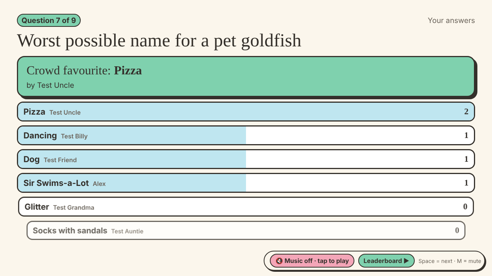
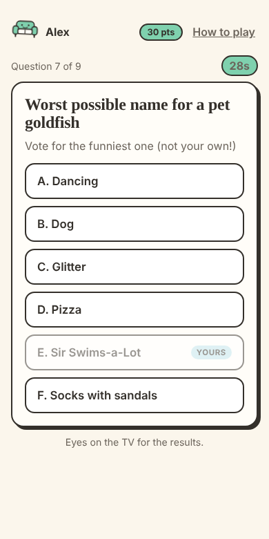
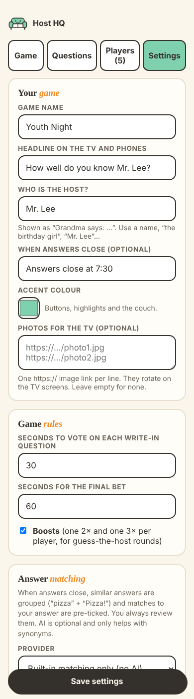

# Couchside

A phone + TV party game for homes and small groups: birthdays, youth nights, family dinners.
Guests scan a QR code, answer questions on their phones, then everyone votes together at the TV.
No app, no accounts, and it runs on Cloudflare's free plan.

[](https://deploy.workers.cloudflare.com/?url=https://github.com/samchan/couchside)

| TV | Phone | Host settings |
|---|---|---|
|  |  |  |

## How it plays

1. **Answer** (any time before the cut-off): guests scan the QR on the TV and answer the questions on their phones.
2. **Vote together**: the host closes answers, then the TV takes everyone through the questions one at a time. Phones show the options and a countdown.
3. **Reveal**: the TV shows the most-voted answer, who wrote it, then (for guess-the-host questions) a drumroll and the host's answer, then a leaderboard that animates who climbed and dropped.
4. **Final**: everyone bets up to half their points on one last question. Countdown from 5th place to the winner, with confetti.

### Question types

| Type | What players do | Scoring |
|---|---|---|
| **Multiple choice** | Pick what the host would pick | +5 if right |
| **Guess the host** (write-in) | Write what they think the host would say | +5 if your answer matches the host's, +1 per vote your answer gets, +2 for voting for the right answer, +1 for voting for the most popular one |
| **Funny** (write-in) | Write the funniest answer. No right answer | +2 per vote your answer gets, +1 for voting for the crowd favourite. You can't vote for yourself |
| **Final** (number or multiple choice) | Guess, then bet up to half your points (at least 20) | Right adds the bet, wrong takes it away. For numbers, the exact or closest guess wins |

If nobody writes the host's answer, it's quietly added to the vote list as just another option.

**Boosts** (optional): each player gets one 2× and one 3× boost for the guess-the-host rounds. Right = their +5/+2 points multiplied; wrong = −10 / −15. Turn them off in Settings.

## Set up (about 5 minutes)

### Option A: the Deploy button

1. Click **Deploy to Cloudflare** above. It forks this repo to your GitHub, creates the Worker and its D1 database, and deploys.
2. Set your admin PIN: Cloudflare dashboard → **Workers & Pages** → **couchside** → **Settings** → **Variables and secrets** → add a **Secret** named `ADMIN_PIN` (6+ digits).
3. Open `https://couchside.<your-subdomain>.workers.dev/admin` and log in.

### Option B: the command line

```bash
git clone https://github.com/samchan/couchside && cd couchside
npm install
npx wrangler login
npx wrangler deploy                 # creates the D1 database on first deploy
npx wrangler secret put ADMIN_PIN   # pick 6+ digits
```

The database tables and a starter question pack are created automatically on the first visit. There's no migration step.

> If your Wrangler version asks for a `database_id`, run `npx wrangler d1 create couchside` and paste the id into `wrangler.toml`.

## Before the party

1. **Admin → Settings**: game name, headline, who the host is ("Grandma", "Mr. Lee", "the birthday girl"), accent colour, optional photo links for the TV, vote timer.
2. **Admin → Questions**: load a pack (General, Birthday, Youth group, Family) or write your own, then fill in the host's answers. Import/Export saves question sets as JSON.
3. Open `/tv` on the laptop connected to the TV and log in with the PIN.
4. Optional: print a poster with the QR from `/tv?print=1`.
5. Rehearse: **Admin → Game → Add 5 test players**, play it through, then **Reset game** (the QR code stays the same, so printed posters keep working).

## Run of show

| When | What | Who presses what |
|---|---|---|
| Guests arrive | QR on the TV; guests answer on their phones | nothing |
| Answers close | Announce it | Admin: **Close answers & group them** |
| A minute later | Tap **Show**, merge duplicates, tick groups that match your answer | Admin |
| Game time | Gather at the TV | TV: **Space** (or Admin: **Start TV voting**) |
| Each question | Multiple choice: Space reveals. Write-in: timed vote, then the reveal plays itself. Space → leaderboard → next | TV: Space · Admin: **Reveal now** / **+10s** |
| Final | Timed bet on phones → Space for the countdown to the winner | TV: Space |

TV keys: **Space / →** next, **M** mute music. Lost phone page? **Admin → Players → let back in** shows a QR that logs them back in with their score.

## Answer matching and AI (optional)

When answers close, similar answers are grouped ("pizza", "Pizza!", "pepperoni pizza") and matches to your answer are pre-ticked. You always review them before voting. The built-in matcher handles spelling, punctuation and word overlap with no AI at all. An AI provider only adds synonyms ("soda" = "pop").

Pick one in **Admin → Settings → Answer matching**, paste a key if it needs one, and tap **Save & test**:

| Provider | Key | Notes |
|---|---|---|
| Built-in only | none | Default |
| Cloudflare Workers AI | none | Runs on your own Cloudflare account (free tier covers a party). Default model `@cf/meta/llama-3.3-70b-instruct-fp8-fast`; any Workers AI text model id works |
| OpenAI-compatible | yes | OpenAI, OpenRouter, Groq, Together, or any `/chat/completions` server. Set the base URL for non-OpenAI services |
| Anthropic | yes | Default model `claude-haiku-5-5` |
| TypeSafe Jev | yes | Decision model: asks "same meaning?" yes/no questions with confidence |

Keys are stored in your D1 database and never sent to any browser (admin shows the last 4 characters). To keep the key out of the database entirely, set it as a Worker secret instead: `npx wrangler secret put AI_API_KEY`. A secret overrides a key saved in Settings. If a provider fails mid-game, the built-in groups are used and admin shows the error.

Adding a provider is one function in [`src/ai.js`](src/ai.js).

## What you need

- **Cloudflare** (free plan). It's worked well for our parties, and a home or small-group game shouldn't need more.
- **An AI provider (optional).** If you want AI to help match answers, that provider needs its own account and key. Couchside works fine without one.

## Fair play

- Joining needs the code inside the QR. **Admin → New QR code** rotates it; **Close joining** locks the door.
- Each player gets a random 192-bit token (stored hashed). One answer, one vote and one of each boost per player per question, all enforced on the server, and all scoring happens on the server.
- Host answers never leave the server before their reveal. The final question stays hidden until the final starts.
- The admin PIN is compared in constant time and rate-limited (10 tries / 10 min per IP). Log in on your phone and the TV before the party: sessions last 36 hours.
- Names and answers are length-capped and rendered as plain text only. CSP is `script-src 'self'` (the QR library is vendored).
- **Admin → Players → remove** kicks someone and deletes their answers and votes.

## Develop

```bash
cp .dev.vars.example .dev.vars    # set ADMIN_PIN=4242 for local testing
npx wrangler dev                   # http://localhost:8787  (/play, /tv, /admin)
npm test                           # plays a full game against the dev server (resets it!)
```

No build step and no framework: plain JavaScript in `public/js/`, one Worker in `src/`. See [AGENTS.md](AGENTS.md) for a map of the code.

## Licence

MIT. See [LICENSE](LICENSE). Includes [qrcode-generator](https://github.com/kazuhikoarase/qrcode-generator) by Kazuhiko Arase (MIT).
